# Tuval

**Türk üniversite öğrencileri ve KOBİ'ler için Türkçe öncelikli, tamamen düzenlenebilir AI sunum aracı.**

Konuyu yaz, sunum tipini ve temayı seç. Yapay zekâ düz bir görsel değil, **eleman bazında düzenlenebilir** bir slayt destesi kurar. Desteyi tarayıcıda düzenler, PowerPoint'te düzenlenebilir **PPTX** olarak veya **PDF** olarak indirirsin.

> Bu proje, YC Fall 2026 şirketi [Moda](https://www.ycombinator.com/companies/moda-2)'nın ("Fully editable slides, designs and video") yerelleştirilmiş bir klonudur. Ders ödevi için geliştirilmiştir; Moda ile bir bağı yoktur.

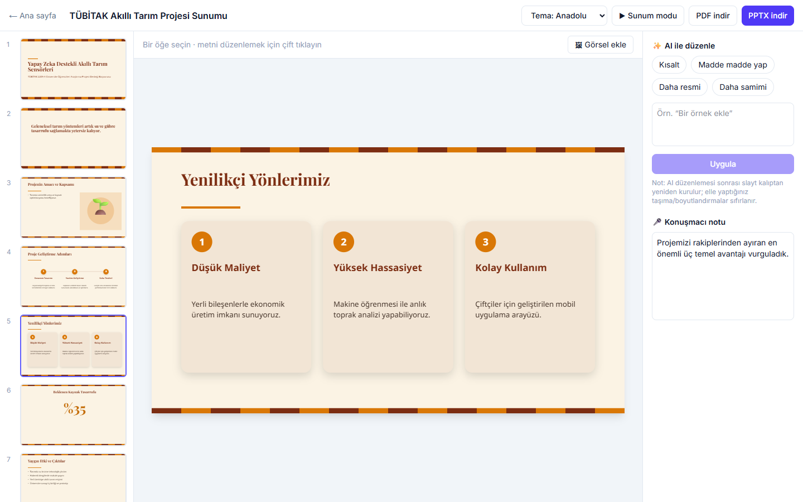

## İçindekiler

- [Ekran görüntüleri](#ekran-görüntüleri)
- [Neden Tuval?](#neden-tuval)
- [Özellikler](#özellikler)
- [Nasıl çalışır?](#nasıl-çalışır)
- [Slayt düzenleri](#slayt-düzenleri)
- [Temalar](#temalar)
- [Sunum tipleri](#sunum-tipleri)
- [Dışa aktarma](#dışa-aktarma)
- [Tasarım ilkeleri](#tasarım-ilkeleri)
- [Kurulum](#kurulum)
- [API](#api)
- [Veri modeli](#veri-modeli)
- [Proje yapısı](#proje-yapısı)
- [Bilinen sınırlamalar](#bilinen-sınırlamalar)
- [Yol haritası](#yol-haritası)

## Ekran görüntüleri

### Başlangıç sayfası

Konuyu yaz, sunum tipini, temayı ve marka kitini seç. Tema kartları, temanın kendi renkleriyle gerçek bir slaydı önizler.

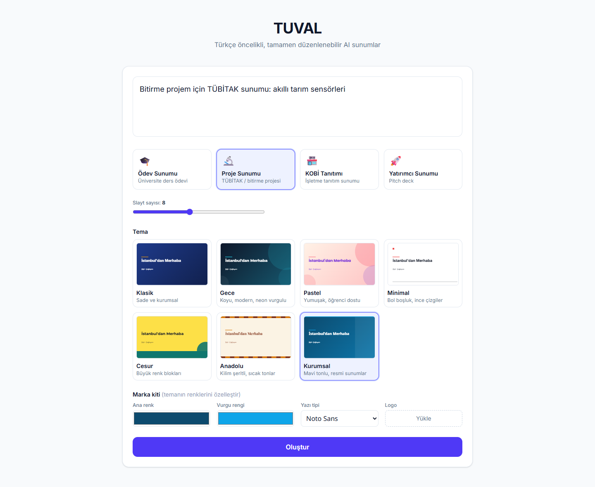

| Tema seçimi | Türkçe karakter doğruluğu |
|---|---|
| 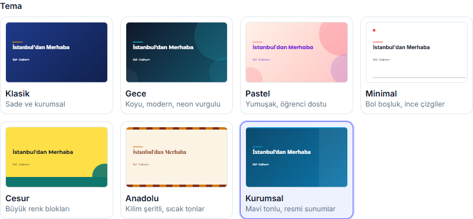 | 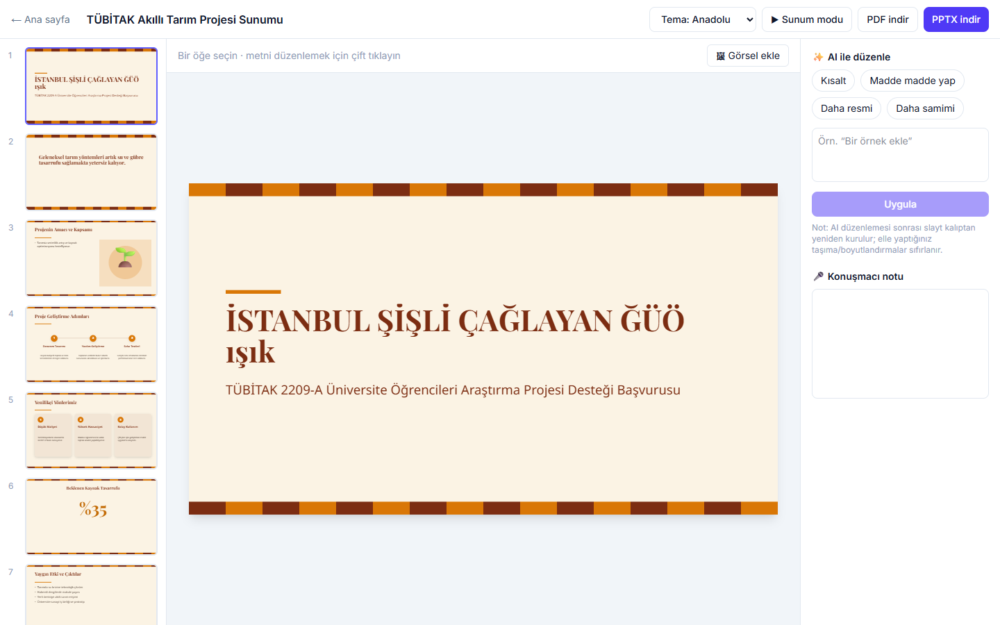 |

### Editör

Sol: slayt listesi (sürükleyerek sırala, çoğalt, sil). Orta: tuval. Sağ: AI düzenleme ve konuşmacı notu. Üst: tema, sunum modu, PDF ve PPTX.

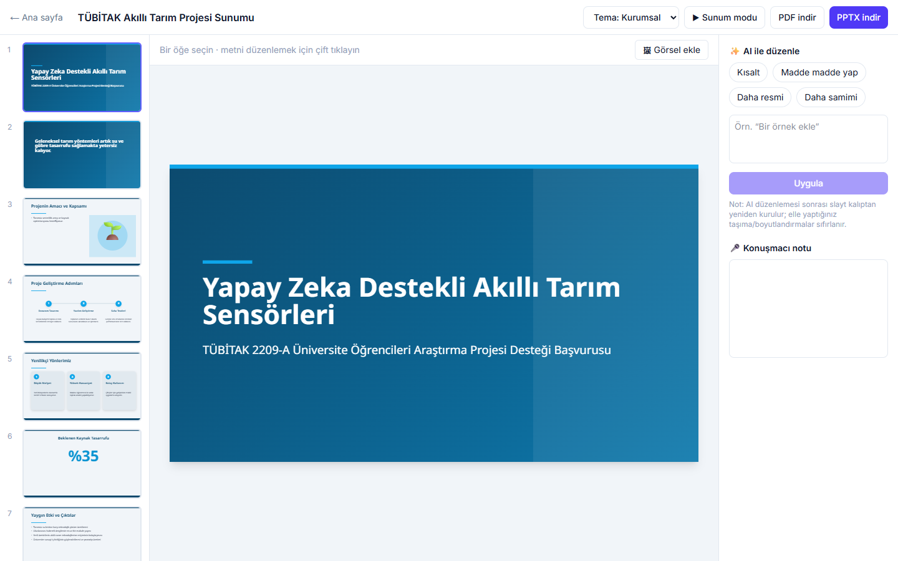

**Seçili öğede araç çubuğu:** yazı boyutu, renk, kalın/italik, hizalama, silme. Metni yerinde düzenlemek için çift tıkla; öğeleri sürükle ve boyutlandır.

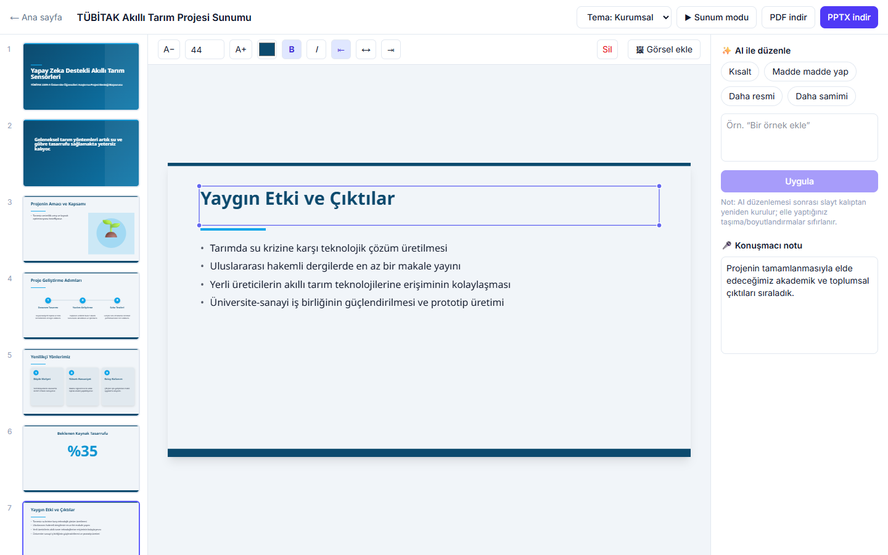

**AI ile düzenleme:** "Kısalt", "Madde madde yap", "Daha resmi", "Daha samimi" veya serbest bir talimat. Yukarıdaki slaytın "Kısalt" sonrası hâli:


### Slayt düzenleri

| Kartlar (gruplama) | Yol haritası |
|---|---|
| 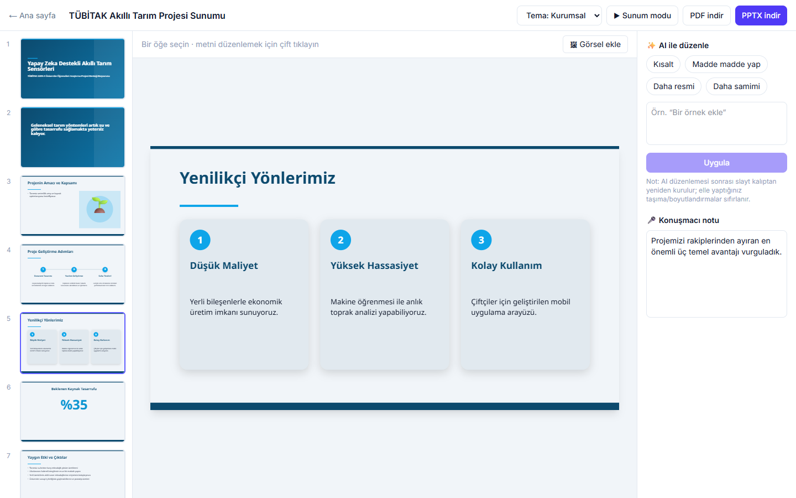 | 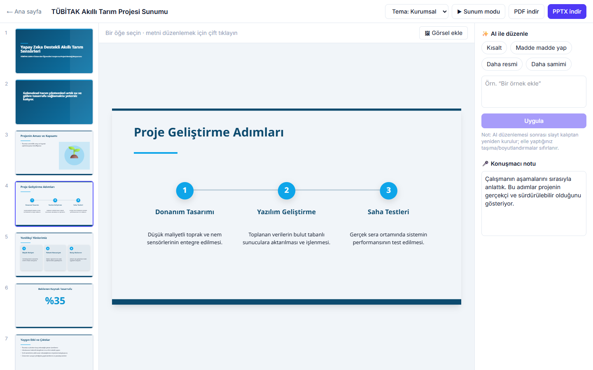 |
| **Büyük rakam** | **Görsel + metin** |
| 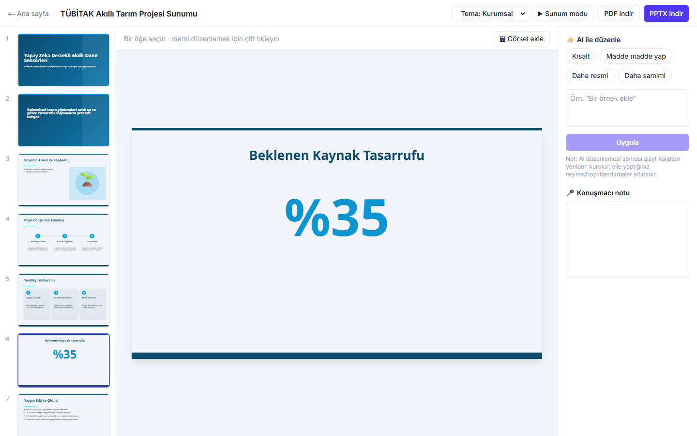 | 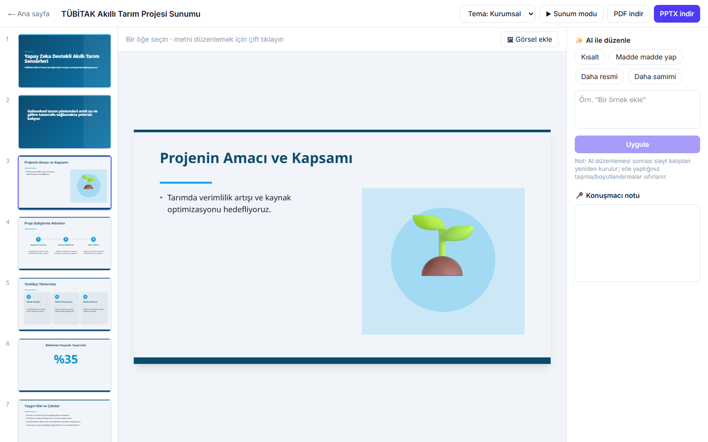 |

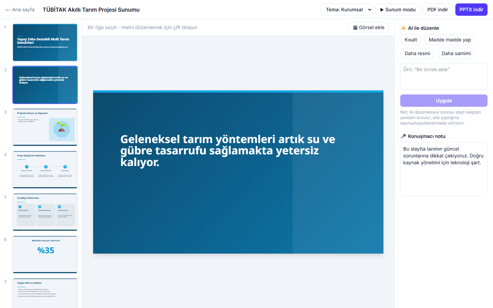

### Temalar

Aynı içerik, farklı tema. Tema, editörden tek tıkla değiştirilir ve tüm slaytlar yeniden kurulur.

| Gece | Anadolu |
|---|---|
| 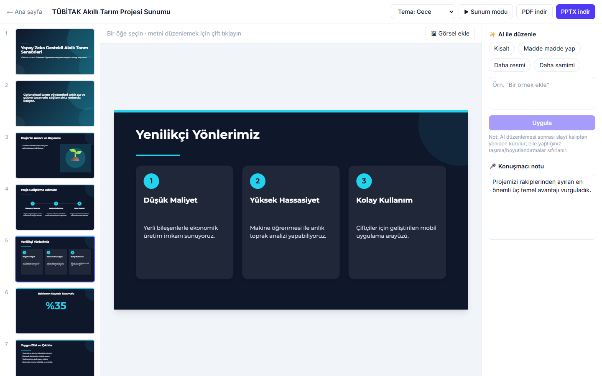 |  |

### Sunum modu

Tam ekran, ok tuşlarıyla geçiş, `Esc` ile çıkış.

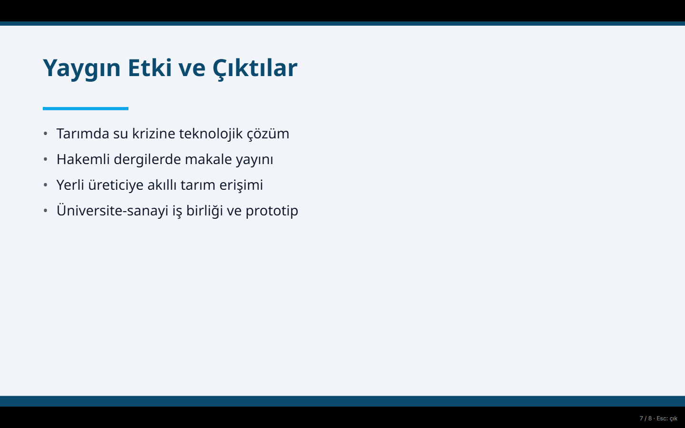

## Neden Tuval?

Mevcut sunum araçlarının çoğu İngilizce öncelikli çalışır ve Türkçe karakterleri bozabilir. Klasik örnek: `"istanbul".toUpperCase()` sonucu `ISTANBUL` olur, doğrusu `İSTANBUL`'dur. Ayrıca öğrenci ödevi, TÜBİTAK projesi veya KOBİ tanıtımı için hazır bir yapı sunmazlar.

Tuval bu boşluğu üç şekilde kapatır:

1. **Türkçe doğruluğu:** harf dönüşümleri `tr-TR` kurallarıyla yapılır (`src/lib/turkish.ts`), fontlar `latin-ext` alt kümesiyle yüklenir, yapay zekâya Türkçe yönergeler verilir.
2. **Türkiye'ye özgü sunum tipleri:** ödev, TÜBİTAK/bitirme projesi, KOBİ tanıtımı, yatırımcı sunumu; her biri kendi akışıyla.
3. **Gerçekten düzenlenebilir çıktı:** metinler PowerPoint'te gerçek metin kutuları olarak açılır; resim değildir.

## Özellikler

- **Prompt'tan deste:** tek bir cümleden 5-12 slaytlık Türkçe sunum, konuşmacı notlarıyla birlikte.
- **11 slayt düzeni:** başlık, bölüm, maddeler, iki sütun, büyük rakam, alıntı, görsel + metin, kartlar, yol haritası, vurgu cümlesi, kapanış.
- **7 özgün tema:** Klasik, Gece, Pastel, Minimal, Cesur, Anadolu, Kurumsal. Gradyan kapaklar, süs şekilleri, serif/sans font eşleştirmesi.
- **Marka kiti:** ana renk, vurgu rengi, font (Inter, Poppins, Montserrat, Noto Sans), logo yükleme.
- **Editör:** sürükle/boyutlandır, yerinde metin düzenleme, slayt ekle/sil/çoğalt/sırala, kendi görselini ekle, konuşmacı notu.
- **AI ile slayt düzenleme:** hazır komutlar ve serbest metin.
- **Sunum modu:** tam ekran, klavye ile gezinme.
- **Otomatik kayıt:** her değişiklik `localStorage`'a kaydedilir; sayfa yenilenince deste kaybolmaz. Hesap ve veritabanı yoktur.
- **Dışa aktarma:** düzenlenebilir PPTX ve PDF.
- **Dayanıklı yapay zekâ katmanı:** model yoğunluğunda (503/429/zaman aşımı) otomatik yedek modele geçer ve yeniden dener.

## Nasıl çalışır?

Ana fikir: **yapay zekâ serbest koordinat üretmez.** Yalnızca düzen kalıbı adı ve içerik üretir; koordinatları kod hesaplar. Böylece taşan veya üst üste binen metin olmaz. Kullanıcı sonradan her elemanı yine serbestçe taşıyabilir.

```
prompt ──► /api/generate (Gemini) ──► DeckContent (düzen + içerik)
                                         │
                                  sanitize (doğrulama, kısaltma)
                                         │
                                  layoutEngine (kod, koordinatlar)
                                         ▼
                              Deck (elemanlar + koordinatlar) ──► Tuval / PPTX / PDF
```

1. **Üretim:** `/api/generate`, Gemini'den şemaya uygun JSON (`responseSchema`) ister. Çıktı `sanitize.ts` ile doğrulanır: bilinmeyen düzen `title-bullets`'e düşer, maddeler 5'e, bir madde ~14 kelimeye, alt başlık ilk cümleye indirilir; model tek paragraf verirse cümlelere bölünür.
2. **Yerleşim:** `layoutEngine.ts` düzen kalıbına göre eleman koordinatlarını hesaplar (1280×720 tuval, 80 px kenar boşluğu). Madde sayısına göre font boyutu otomatik küçülür.
3. **Düzenleme:** AI düzenlemesi, slaytın içeriğini (elle yapılan metin değişiklikleri dahil) tuvalden geri toplar, modele gönderir ve slaytı kalıptan yeniden kurar. Bu yüzden elle yapılan taşıma/boyutlandırmalar sıfırlanır; arayüz bunu belirtir.
4. **Dışa aktarma:** her eleman PPTX'te gerçek bir metin kutusuna veya şekle dönüşür (`px / 96` inç, `px × 0,75` pt).

## Slayt düzenleri

| Düzen | Kullanım | Yapısı |
|---|---|---|
| `title` | Açılış | Büyük başlık, alt başlık, gradyan veya düz zemin |
| `section` | Bölüm ayracı | Dikey vurgu şeridi, büyük başlık |
| `title-bullets` | Klasik içerik | Başlık + 3-5 madde |
| `two-column` | Karşılaştırma | İki başlıklı sütun, her birinde 2-4 madde |
| `big-number` | Çarpıcı veri | Tek dev rakam + tek cümlelik açıklama |
| `quote` | Alıntı | Tırnak süsü, italik alıntı, yazar |
| `split` | Görsel + metin | Solda metin, sağda emoji ikonlu panel (kendi görselini ekleyebilirsin) |
| `cards` | Gruplama | 2-4 kart, numara rozeti, yumuşak gölge |
| `steps` | Yol haritası / zaman planı | Soldan sağa numaralı duraklar |
| `statement` | Vurgu cümlesi | Tek cümle, güçlü zemin |
| `closing` | Kapanış | `title` ile aynı yapı |

## Temalar

| Tema | Karakter | Varsayılan font |
|---|---|---|
| Klasik | Sade, kurumsal, gradyan kapak | Inter |
| Gece | Koyu, neon vurgulu | Montserrat |
| Pastel | Yumuşak, öğrenci dostu | Poppins |
| Minimal | Bol boşluk, ince çizgiler | Inter |
| Cesur | Büyük renk blokları | Montserrat |
| Anadolu | Kilim şeritli, sıcak tonlar, serif başlık (Playfair Display) | Noto Sans |
| Kurumsal | Mavi tonlu, resmi sunumlar | Noto Sans |

Tema; arka planı, süs şekillerini, renk paletini ve (Anadolu'da) başlık fontunu belirler. Marka kitindeki renkler ve font tema üzerinden özelleştirilebilir. Seçilen renk ne olursa olsun metin kontrastı **en az 4,5:1** olacak şekilde otomatik düzeltilir (WCAG).

## Sunum tipleri

Her tip, yapay zekâya farklı bir akış önerir:

| Tip | Akış | Önerilen tema |
|---|---|---|
| `odev` | giriş → konu başlıkları → örnekler → sonuç → kaynaklar | Pastel |
| `proje` | problem → amaç → yöntem → iş paketleri/zaman planı → beklenen çıktılar → yaygın etki | Kurumsal |
| `kobi` | biz kimiz → ürün/hizmet → neden biz → referanslar → iletişim | Anadolu |
| `yatirimci` | problem → çözüm → pazar → ürün → iş modeli → ekip → yatırım talebi | Cesur |

## Dışa aktarma

**PPTX** (`src/lib/exportPptx.ts`, `pptxgenjs`): `LAYOUT_WIDE` (13,333 × 7,5 inç). Metinler gerçek metin kutuları, madde listeleri gerçek madde işaretleri, şekiller gerçek şekiller (elips, yuvarlak dikdörtgen, saydamlık, gölge), konuşmacı notları PPTX notları olarak yazılır. Gradyan kapaklar, PPTX arka planı tek renk olabildiği için arka plan görseli olarak gömülür; üzerindeki metinler yine düzenlenebilirdir.

**PDF** (`src/lib/exportPdf.ts`): her slayt ekran dışında 1280×720 render edilir, `html-to-image` ile PNG'ye çevrilir (pixelRatio 2), `jsPDF` ile sıkıştırılarak birleştirilir. Fontlar PDF'e gömülü görüntü olarak girdiği için her bilgisayarda aynı görünür. 8 slaytlık bir deste yaklaşık 1 MB'dır.

> Gerçek bir tarayıcı indirmesiyle doğrulandı: 8 slaytlık PPTX'te 8 konuşmacı notu ve gerçek metin kutuları, 8 sayfalık PDF.

## Tasarım ilkeleri

Slayt kalitesi için şu ilkeler kodda ve yapay zekâ yönergelerinde uygulanır:

- **Az metin:** slayt başına tek fikir, en fazla 5 madde, madde ≤ 12 kelime, başlık ≤ 8 kelime. Fazlası otomatik kısaltılır.
- **Gruplama (chunking):** 3-4 paralel fikir `cards` düzenine, sıralı süreçler `steps` düzenine gider; madde işareti listesi son çare olur.
- **Tipografik hiyerarşi:** büyük başlıkta sıkı (1,05), gövdede geniş (1,4-1,5) satır aralığı; başlık ile gövde arasında belirgin boyut farkı.
- **Boşluk:** 80 px kenar boşluğu, başlıklar köşeye yapışmaz, kartlarda geniş iç boşluk.
- **Kontrast:** metin/zemin kontrastı ≥ 4,5:1 (büyük metinde ≥ 3:1) garanti edilir.
- **Tutarlı gölge ve tek estetik:** kartlarda aynı yumuşak gölge, tema boyunca tek görsel dil.
- **Kalıp çeşitliliği:** aynı düzen art arda ikiden fazla kullanılmaz.
- **Serif + sans eşleştirmesi:** farklı aileden iki font (Anadolu teması).

Bu ilkeler şu kaynaklardan derlenmiştir:

- Ines Montani, [A beginner's guide to making beautiful slides for your talks](https://ines.io/blog/beginners-guide-beautiful-slides-talks)
- Slidor, [15 essential and illustrated rules for PowerPoint presentation design](https://www.slidor.agency/blog/15-regles-illustrees-pour-ameliorer-le-design-de-vos-presentations-powerpoint)
- Plus AI, [How to make PowerPoint slides that look good](https://plusai.com/blog/how-to-make-powerpoint-slides-that-look-good/)
- Free PowerPoint Templates, [Expert design tips for visually appealing slides](https://www.free-power-point-templates.com/articles/expert-design-tips-for-visually-appealing-slides-in-powerpoint/)

Hazır şablonlar kopyalanmamıştır; temalar bu ilkelerden esinlenen özgün tasarımlardır.

## Kurulum

Gereksinimler: Node.js 20+ ve ücretsiz bir [Gemini API anahtarı](https://aistudio.google.com/apikey).

```bash
git clone https://github.com/ervakeskin/tuval.git
cd tuval
npm install
cp .env.example .env.local   # GEMINI_API_KEY değerini doldur
npm run dev
```

Tarayıcıda `http://localhost:3000` adresini aç.

| Değişken | Açıklama |
|---|---|
| `GEMINI_API_KEY` | Gemini API anahtarı (zorunlu). Yalnızca sunucuda kullanılır, istemci paketine girmez. |
| `GEMINI_MODEL` | Ana model. Varsayılan `gemini-flash-latest`. |
| `GEMINI_FALLBACK_MODEL` | Ana model yoğunken denenen yedek. Varsayılan `gemini-flash-lite-latest`. |

Diğer komutlar:

```bash
npm run build   # üretim derlemesi
npm run lint    # ESLint
npx tsc --noEmit
```

**Vercel'e dağıtım:** repoyu Vercel'e bağla ve `GEMINI_API_KEY` (isteğe bağlı olarak diğer iki değişkeni) proje ortam değişkenlerine ekle. Başka ayar gerekmez; veritabanı yoktur.

## API

Her iki uç nokta da Gemini'yi `responseMimeType: "application/json"` ve `responseSchema` ile çağırır. Geçici hatalarda (429, 503, 504, zaman aşımı) sırayla ana model → yedek model → ana model → yedek model denenir. Hepsi başarısız olursa Türkçe bir hata mesajı döner.

### `POST /api/generate`

```jsonc
// istek
{
  "prompt": "Bitirme projem için TÜBİTAK sunumu: akıllı tarım sensörleri",
  "deckType": "proje",          // odev | proje | kobi | yatirimci
  "slideCount": 8,              // 4-12, varsayılan 8
  "brand": { "primary": "#0c4a6e", "accent": "#0ea5e9", "font": "Noto Sans", "theme": "kurumsal" }
}
// yanıt
{ "title": "…", "slides": [ /* Slide[] */ ] }
```

### `POST /api/edit`

```jsonc
// istek
{ "slide": { /* SlideContent */ }, "instruction": "Kısalt" }
// yanıt
{ "slide": { /* güncellenmiş SlideContent */ } }
```

## Veri modeli

Tuval 1280 × 720 px'tir (16:9). Ayrıntılar `src/lib/types.ts` içindedir.

```ts
type Deck = { id; title; deckType; brand: Brand; slides: Slide[]; updatedAt };
type Brand = { primary; accent; font; logo?; theme? };
type Slide = {
  id; layout; background; gradient?; elements: SlideElement[];
  notes?;                // konuşmacı notu → PPTX notları
  content?: SlideContent; // slaytın üretildiği içerik (AI düzenleme için)
};
type SlideElement = {
  id; type: "text" | "shape" | "image"; x; y; w; h;
  text?; role?; style?; font?;           // metin
  fill?; shape?: "rect" | "ellipse" | "round"; opacity?; shadow?; locked?;  // şekil
  src?;                                   // görsel (data URL)
};
```

## Proje yapısı

```
src/
  app/
    page.tsx                   # Başlangıç sayfası
    editor/[id]/page.tsx       # Editör
    api/generate/route.ts      # Deste üretimi
    api/edit/route.ts          # AI slayt düzenleme
  components/
    SlideCanvas.tsx  SlideElementView.tsx  SlideThumbnails.tsx
    AiPanel.tsx  Toolbar.tsx  BrandKitForm.tsx  ThemePicker.tsx  PresentMode.tsx
  lib/
    config.ts        # APP_NAME ve tuval boyutu (isim tek yerden değişir)
    types.ts         # veri modeli
    layoutEngine.ts  # düzen kalıpları, koordinatlar, içerik geri toplama
    themes.ts        # temalar, gradyan, kontrast yardımcıları
    gemini.ts        # şema, yeniden deneme, yedek model
    prompts.ts       # Türkçe sistem yönergeleri
    sanitize.ts      # model çıktısını doğrulama ve kısaltma
    fonts.ts  storage.ts  turkish.ts
    exportPptx.ts  exportPdf.ts
docs/screenshots/    # bu README'deki ekran görüntüleri
```

**Teknoloji:** Next.js (App Router) · TypeScript · Tailwind CSS · Gemini API (`@google/genai`) · react-rnd · pptxgenjs · html-to-image + jsPDF.

## Bilinen sınırlamalar

- **Ücretsiz kota:** Gemini ücretsiz katmanı istek ve günlük kota sınırlarına sahiptir. Ana model yoğunken yedek model devreye girer ve içerik kalitesi biraz düşebilir. Üretim süresi genelde 5-25 sn'dir.
- **Yapay zekâ içeriği:** istatistikler ve alıntılar doğrulanmaz. Sunmadan önce kontrol et. Yönergeler model uydurma kişi/kurum/iletişim bilgisi yazmasın diye uyarsa da bu garanti edilemez.
- **AI düzenleme:** slayt kalıptan yeniden kurulduğu için elle yapılan taşıma ve boyutlandırmalar sıfırlanır. Tema değişikliğinde de aynısı olur.
- **Yazı tipleri PPTX'te:** PPTX yazı tipi adını taşır, gömmez. Dosyayı açan bilgisayarda Playfair Display, Poppins vb. kurulu değilse PowerPoint yedek font kullanır. Dışarıya göndermek için PDF daha güvenlidir.
- **Depolama:** desteler yalnızca tarayıcının `localStorage`'ında durur (hesap yok, cihazlar arası senkronizasyon yok). Logo en fazla 500 KB, yüklenen görseller 1200 px'e küçültülür.
- **Tema süsleri** tuvalde kilitlidir; kaldırmak için temayı değiştir.
- **Test:** otomatik test paketi yoktur; doğrulama TypeScript, ESLint ve elle/tarayıcı üzerinden yapılmıştır. PPTX'in PowerPoint ve Google Slides'ta görsel olarak açılışı ayrıca elle denenmelidir.

## Yol haritası

- Video ve animasyon
- Gerçek zamanlı ortak çalışma
- Yapay zekâ ile görsel üretimi veya ücretsiz stok görsel entegrasyonu
- Instagram carousel (1080×1080) sunum tipi
- Google Slides'a aktarma
- Yapay zekâ ile tema ve renk önerisi
